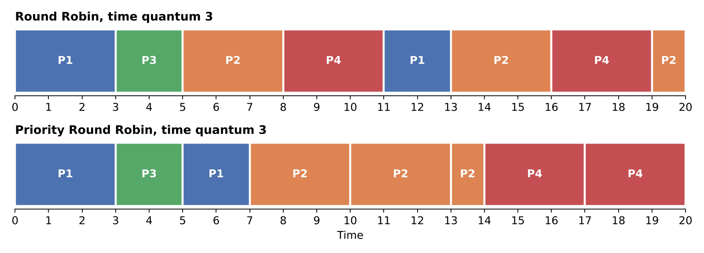
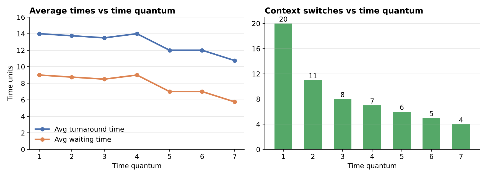

# Round Robin CPU Scheduler

A Java simulator for Round Robin CPU scheduling, the way an operating system shares one CPU between many processes. You give it a list of processes and a time quantum. It prints every scheduling event as it happens, then reports how well the schedule performed.

I also built a Priority Round Robin mode, where the ready process with the highest priority always runs next.



## What it does

The program reads processes from a CSV file (process ID, arrival time, burst time) and simulates them on a single CPU:

* Processes join a FIFO ready queue when they arrive
* The CPU runs each process for at most one time quantum
* If a process isn't finished when its quantum runs out, it's preempted and goes to the back of the queue
* The clock records when each process starts, gets preempted, resumes and finishes

When the simulation ends it prints:

* Average turnaround time
* Average waiting time
* CPU utilization
* Throughput
* Number of context switches and idle time

If the CSV has a fourth column for priority, the program switches to Priority Round Robin on its own. A lower number means a higher priority.

## Results

I ran the same four processes with different time quanta to see how the quantum size changes the schedule.

| Time quantum | Context switches | Avg waiting time | Avg turnaround time | CPU utilization | Throughput |
|:---:|:---:|:---:|:---:|:---:|:---:|
| 2 | 11 | 8.75 | 13.75 | 94.5% | 0.2 |
| 3 | 8 | 8.50 | 13.50 | 96.0% | 0.2 |
| 4 | 7 | 9.00 | 14.00 | 96.5% | 0.2 |
| 5 | 6 | 7.00 | 12.00 | 97.0% | 0.2 |
| 7 | 4 | 5.75 | 10.75 | 98.0% | 0.2 |



What I found:

* **A small quantum means a lot of switching.** Quantum 1 caused 20 context switches. Quantum 7 caused only 4. Each switch costs CPU time (the simulator counts 0.1 time units per switch), so utilization went up from 94.5% to 98% as the quantum got bigger.
* **Waiting time doesn't always improve in a straight line.** Quantum 4 was actually a bit worse than quantum 3, because of the order processes ended up in the queue.
* **A very large quantum turns Round Robin into First Come First Served.** The longest burst in this test is 7, so at quantum 7 every process finishes in one turn. That gave the lowest waiting time here, but with many processes it would make short jobs wait behind long ones, which Round Robin is meant to prevent.
* **Throughput stayed at 0.2** for every quantum. All the work still takes 20 time units in total. The quantum only changes the order.
* **Priority helps the important jobs.** With priorities and quantum 3, average waiting time dropped from 8.5 to 5.75, but the lowest priority process had to wait until the end.

The original program output for each run is in the [screenshots](screenshots) folder.

## How to run it

You need Java 8 or newer. From the project folder:

```
javac -d out src/Scheduler.java
java -cp out Process data/processes.csv 3
```

The first argument is the CSV file and the second is the time quantum. To try the priority version:

```
java -cp out Process data/processes_priority.csv 3
```

Example output:

```
Round Robin Scheduling (Time Quantum = 3)
Time 0: Process 1 added to queue.
Time 0: Process 3 added to queue.
Time 0: Process 1 starts running.
Time 0 to 3: Process 1 runs for 3 unit(s).
Time 3: Process 2 added to queue.
Time 3: Process 4 added to queue.
Time 3: Process 1 is preempted.
...
--- Performance Metrics ---
Total execution time: 20 time unit(s).
Context switches: 8
Average Turnaround Time: 13.5
Average Waiting Time: 8.5
CPU Utilization: 96.0%
Throughput: 0.2 processes per time unit.
```

## Input format

```
pid,arrivalTime,burstTime
1,0,5
2,1,7
3,0,2
4,2,6
```

For the priority mode, add a priority column:

```
pid,arrivalTime,burstTime,priority
1,0,5,1
2,1,7,2
3,0,2,1
4,2,6,3
```

## Project structure

```
src/Scheduler.java              the simulator (both scheduling modes)
data/processes.csv              sample input for Round Robin
data/processes_priority.csv     sample input with priorities
images/                         charts used in this README
screenshots/                    program output for quantum 2, 3, 4, 5 and 7
```

## About

I built this for my Operating Systems course (CSCI 330). The goal was to understand how preemptive scheduling works in practice and how one setting, the time quantum, affects responsiveness against overhead.

**Skills:** Java, CPU scheduling algorithms, queues, simulation, performance analysis
